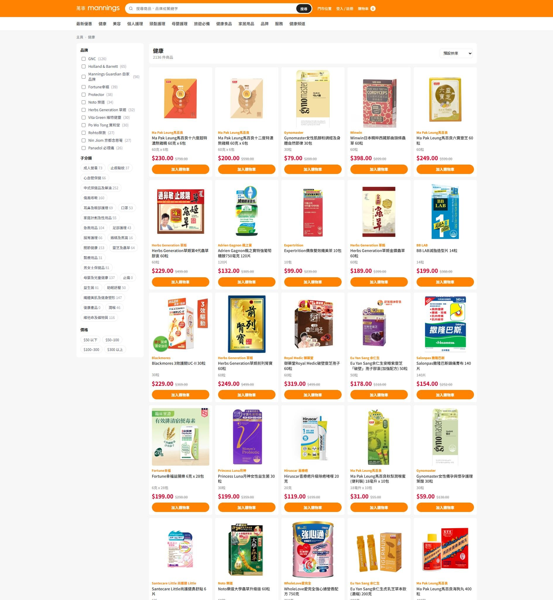
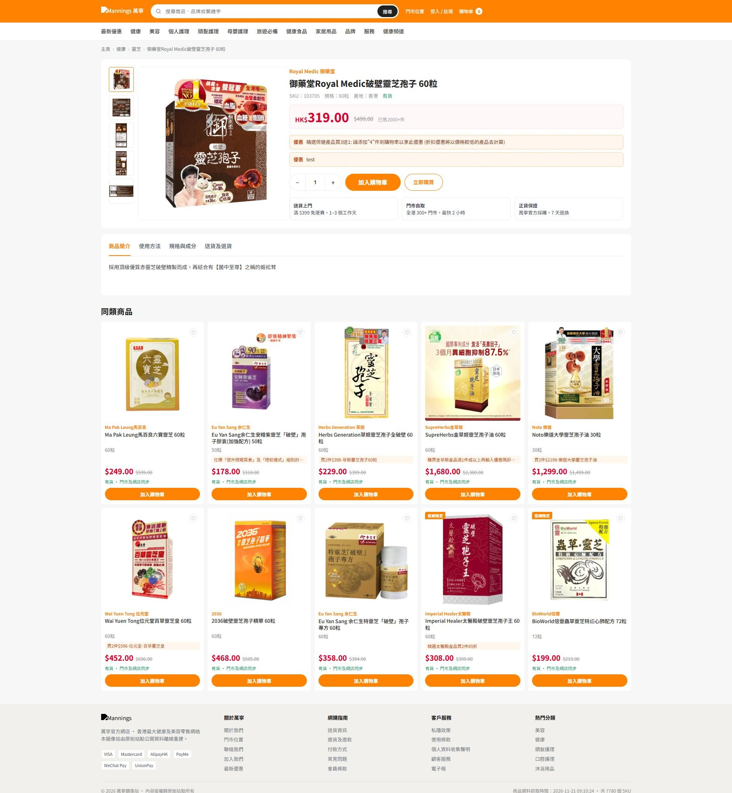

# 萬寧香港官方網店 · 完整鏡像站（mannings.com.hk）

把 [www.mannings.com.hk](https://www.mannings.com.hk)（Magento PWA / Venia + 獨立搜索網關）**整站鏡像成本地可離線瀏覽的靜態站**：
全部商品、SKU、分類、品牌、圖片、CMS 內容與頁面結構，並附完整數據導出。

```
商品 7,780 個 SKU（站內 total_count 7,802，覆蓋 99.7%）
分類   307 個（真實 155 + 菜單層級補齊，含 2/3/4 級）
品牌   999 個
圖片 28,930 個檔案 / 425 MB（本地 .webp 派生圖）
頁面 9,118 個靜態 HTML（另 307 個分類 JSON 索引）
```





## 快速開始

```bash
npm run serve        # 本地預覽 http://127.0.0.1:8787
npm run ship         # build + export + verify（重建站點與數據）
```

只想要數據：看 `data/exports/`

| 檔案 | 內容 |
| --- | --- |
| `data/exports/skus.csv` | 全量 SKU 表：名稱、品牌、規格、原價/售價/折扣、庫存、分類、圖片、本地頁面路徑 |
| `data/exports/products.json` | 商品明細（描述 / 用法 / 成分 / 產地 / 分類） |
| `data/exports/categories.csv` | 分類樹（uid、url_path、層級、商品數） |
| `data/exports/brands.csv` | 品牌與商品數 |
| `data/exports/stats.json` | 抓取時間、總量、價格區間 |

## 站點結構

```
site/
  index.html              首頁（主視覺 + 快捷入口 + 熱賣/新品/限定 + 分類貨架）
  c/<url_path>.html       分類頁 155 個（品牌篩選、價格區間、排序、分頁）
  p/<sku>.html            商品頁 7,780 個（圖集、階梯價、優惠、規格、同類推薦）
  b/<slug>.html           品牌頁 999 個 + brands.html 品牌總覽
  offers/<id>.html        CMS 推廣頁（promotions / brandzone / travelessentials / mannings_exclusive …）
  info/<id>.html          CMS 資訊頁（私隱政策、條款、送貨、退貨 …）
  search.html             全站檢索（7,780 SKU 客戶端搜尋）
  cart.html / checkout.html / login.html   購物車、結帳、登入（離線演示，localStorage）
  assets/                 样式与前端脚本
  data/catalog.json       前端檢索與購物車用的輕量商品索引
  media/                  本地圖片（與原站 /media/ 路徑一一對應）
```

## 抓取架構（為什麼分成兩套 HTTP 通道）

原站有兩個數據源，且邊緣（Fastly/Varnish）會對 TLS 指紋做攔截：

| 數據源 | 端點 | 用途 |
| --- | --- | --- |
| Magento GraphQL | `GET https://www.mannings.com.hk/graphql?query=…&operationName=…` | 商品詳情（`productsV3`）、分類、CMS、菜單 |
| 商品搜索網關 | `POST https://gw.dfgd-os.com/search-gateway-hkmn/search/graphql` | 全站商品列舉、分頁、facets（分類/品牌/價格） |

關鍵點：

- **Node/undici、curl（OpenSSL 系）打 `www.mannings.com.hk` 一律 403**，只有 .NET/SChannel 通道放行 →
  抓取器用 PowerShell + `System.Net.Http.HttpClient`（`scripts/ps/fetch.ps1`），Node 只做數據處理與建站。
- 搜索網關 `page_size` 上限 **60**，全站 131 頁；`phrase:""` + `visibility` filter 可列舉全部在線商品。
- 商品詳情用 `productsV3(filter:{sku:{in:[…]}})` **每批 30 個 SKU** 抓完整 PDP fragment，260 批完成。
- 圖片走原站圖片 CDN 的派生參數：`?optimize=high&fit=bounds&height=500&width=500&format=webp`，
  500px webp 平均 ~9KB，全站圖集 260MB 級別。

### 重跑整條流水線

```bash
npm run crawl        # 全部抓取（meta → 列表 131 頁 → PDP 260 批 → CMS → 分類 → 圖片 3 萬張）
npm run normalize    # 合併成 data/catalog.json + data/details.json
npm run plan:media   # 生成圖片任務清單（含 .webp 路徑映射）
npm run build        # 生成 8,950+ 靜態頁面
npm run export       # 導出 CSV / JSON
npm run verify       # 死鏈/缺圖/SKU 覆蓋自檢
```

抓取全程可續跑：列表頁、PDP 批次、圖片都以文件名判斷是否已完成，中斷後重跑不會重抓。

## 頁面與數據對應

- 商品頁 `site/p/<sku>.html` 內嵌 `application/ld+json`（schema.org Product），描述、用法、成分、
  規格屬性、優惠文案全部來自原站 PDP fragment。
- 分類頁的 `__CAT__` 內聯了該分類全部商品（SKU/名稱/圖/價），前端做排序、品牌與價格篩選、每頁 40 件分頁。
- CMS 頁面直接使用原站 PageBuilder HTML（媒體路徑改寫到本地 `/media/*.webp`），保留原始版面與文案。
- 全站內鏈改寫規則見 `scripts/03-build.mjs` 的 `rewriteHtml()`。

## 已知邊界

- 原站是 React PWA，商品列表/詳情靠 JS 渲染；本鏡像是**用同一批數據重建的靜態站**，
  版面按原站設計語言（#FF8300 主色、Noto Sans TC、白色卡片 + 圓角 CTA）重寫，非逐像素複刻。
- 圖片為 500px webp 派生圖（原始大圖未鏡像），PDP 圖集數量與原站一致。
- 帳戶、支付、下單為離線演示：購物車存 `localStorage`，結帳只在本機生成訂單號，不發生任何真實交易。
- 商品數據為抓取時刻快照（見 `data/exports/stats.json` 的 `scrapedAt`），價格與庫存會與原站產生偏差。

## 授權與用途

本倉庫為技術鏡像/離線歸檔用途，站內商品文案、圖片、商標版權歸萬寧（Mannings）及相關品牌方所有。
